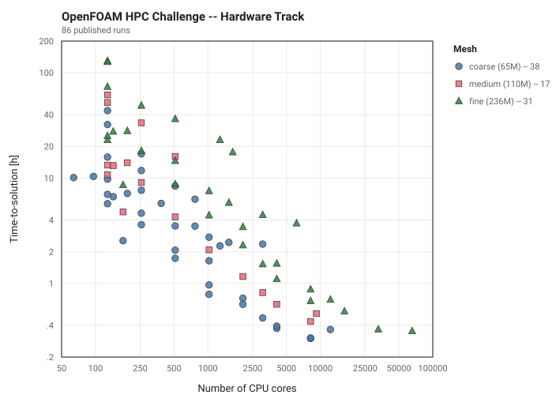
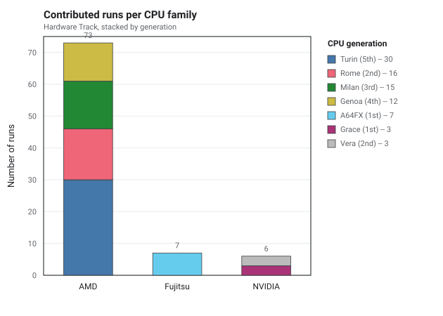

# OHC-DATA

Results of the [OpenFOAM HPC Challenge](https://exafoam.eu/hpc-challenge/),
collected as one dataset.

- [OHC-DATA](#ohc-data)
  - [The dataset](#the-dataset)
  - [Generating the submission data](#generating-the-submission-data)
    - [Requirements](#requirements)
    - [Quick start](#quick-start)
    - [Detailed guide](#detailed-guide)
      - [1. Prepare the runs](#1-prepare-the-runs)
      - [2. Adapt the SLURM template](#2-adapt-the-slurm-template)
      - [3. Describe a compute node](#3-describe-a-compute-node)
      - [4. Submit the runs](#4-submit-the-runs)
      - [5. Harvest the results](#5-harvest-the-results)
      - [6. Validate and submit](#6-validate-and-submit)
    - [Options of benchmark.py](#options-of-benchmarkpy)
  - [Contributing results](#contributing-results)

## The dataset

`data/data.json` is the dataset: one record per simulation, with the 43
measured columns plus `OHC` (the round, 1 or 2) and `Submission Date`. Every
result, from complete rounds to individual submissions, is appended to this
file, and no other dataset is read. `Overview.ipynb` plots from it.





Both are the Hardware Track overview plots of the challenge notebooks.
`scripts/plot_overview.py` draws them from `data/data.json`, using the standard
library only, like the rest of `scripts/`. The `overview-figures` workflow
redraws and commits them whenever the dataset changes, so they stay in step
with the data; `./scripts/plot_overview.py` redraws them locally.

Every record of a round has the date of the workshop where its results were
presented: 2025-06-30 for OHC1 and 2026-06-29 for OHC2.

## Generating the submission data

`scripts/` contains two drivers for the occDrivAer static-mesh case:
`benchmark.py` sets up the runs, and `postprocess.py` extracts the results from
them.

### Requirements

- Python 3.6 or newer. The scripts use only the standard library, so nothing
  needs to be installed; Python itself does the downloading and extracting.
- An ESI OpenFOAM build that the jobs can load (the environment part of the
  SLURM template sets it up), with the tools `Allrun` runs: `decomposePar`,
  `renumberMesh`, `potentialFoam`, `applyBoundaryLayer` and `simpleFoam`. The
  `scotch` and `multilevel-*` decompositions need OpenFOAM built with that
  library. `benchmark.py` checks for it when the OpenFOAM environment is
  loaded and stops if only the dummy stub is installed.
- SLURM on a cluster, for submitting the runs and the probe job with `sbatch`.
  On a workstation, run `Allrun` in each run copy instead.
- Linux, to detect the compute node. On other systems, fill in
  `node-topology.yaml` by hand.
- Internet access where `benchmark.py` runs: the case comes from
  develop.openfoam.com and the meshes from Zenodo. `--polymesh` uses a mesh
  you already have instead. The case is needed even with `--case`, since the
  runs are checked against it; where `benchmark.py` cannot download it,
  `postprocess.py` has to.
- Disk space in the workspace. The mesh downloads are 3.2 GB (coarse), 5.9 GB
  (medium) and 11.5 GB (fine). Extracted, the coarse mesh takes about 7 GB,
  and each coarse run about 11 GB once decomposed; medium and fine scale
  roughly with their cell count.

### Quick start

From benchmark runs on a SLURM cluster to a submission:

```sh
git clone https://github.com/OpenFOAM-HPC-Challenge/OHC-DATA.git
cd OHC-DATA
W=/scratch/$USER/occDrivAer

# 1. Prepare the runs: downloads the case and the mesh, writes the SLURM
#    template and a description of this machine.  Nothing is submitted yet.
./scripts/benchmark.py --mesh coarse --ncores 128,256,512 --workspace $W

# 2. Adapt $W/slurm.template to your site: account, partition, time limit,
#    and the environment that loads OpenFOAM.

# 3. Describe a compute node instead of the login node (skip this on a
#    workstation): writes $W/probe.slurm, a one-node job that does it.
./scripts/benchmark.py --probe-node --workspace $W
(cd $W && sbatch probe.slurm)

# 4. Once the probe job has finished, render the runs again and submit them.
./scripts/benchmark.py --mesh coarse --ncores 128,256,512 --workspace $W --submit

# 5. Once the runs have finished, harvest them.  The first call writes
#    $W/meta.yaml and stops: check the values it filled in, fill in the
#    FIXME fields, then call it again.
./scripts/postprocess.py --workspace $W --format json
./scripts/postprocess.py --workspace $W --format json

# 6. Validate the submission and open a pull request with it.
./scripts/validate_submission.py submissions/<YYYYMMDD>_<suffix>
```

### Detailed guide

#### 1. Prepare the runs

The `benchmark.py` script automates the preprocessing: it downloads the case
and the meshes and decomposes them for the given numbers of ranks. Nothing has
to be in place beforehand:

```sh
./scripts/benchmark.py --mesh coarse --ncores 128,256,512 \
                       --workspace /scratch/$USER/occDrivAer
```

This downloads the
[occDrivAerStaticMesh case](https://develop.openfoam.com/committees/hpc/-/tree/develop/incompressible/simpleFoam/occDrivAerStaticMesh)
from the develop branch of the OpenFOAM HPC committee repository into
`<workspace>/case`, records it in `<workspace>/case-manifest.json` together
with the commit it was at, and downloads the requested polyMesh
resolutions from Zenodo (coarse, medium and fine, unless `--mesh` selects
fewer). It then builds one case copy per mesh and core count, with the mesh
symlinked to the shared copy, writes the hierarchical decomposition into each
copy's `system/include/caseDefinition`, and renders a SLURM script beside it.
It also writes the SLURM template (step 2) and the description of the machine
it runs on (step 3); while either of them is new, it submits nothing.

Both downloads happen once and are reused, so a second invocation against the
same workspace downloads nothing, and the workspace stays with the commit it
was set up with. To take up a newer case from develop, delete
`<workspace>/case` and `<workspace>/case-manifest.json`. A mesh you already
have can be copied into the workspace instead: `--polymesh DIR` gives its
`polyMesh` directory, and `--mesh` the one resolution it is. If you put the
scripts into a case checkout of your own, or give one with `--case DIR`, the
runs are copied from that case instead, so your local modifications are kept.
The manifest is still the case on develop: what your case changes makes the
runs Software Track (step 5).

#### 2. Adapt the SLURM template

The sbatch directives come from `<workspace>/slurm.template`, which the first
invocation writes from the built-in default. The default is not set up for any
particular site: set the account, partition, time limit (24 hours by default)
and the environment that loads OpenFOAM. Each invocation renders every
`run.slurm` from the template again, so after editing it, run the same
command again.

The runs launch their parallel steps with `srun -n`, which the template
exports as `MPI_LAUNCHER`; the case's `Allrun` takes it and `OMPI_FLAGS` from
the environment. The `--ranks-per-domain` runs keep `mpirun -np`,
because their placement flags are Open MPI options.

#### 3. Describe a compute node

The description of a compute node comes from `<workspace>/node-topology.yaml`:
sockets, NUMA domains, L3 caches, physical cores and hardware threads per
node, the machine they were detected on, which every run shows, and the CPU,
memory and interconnect that `postprocess.py` describes the hardware with.
Tasks per node, the `multilevel-*` decompositions and the `--ranks-per-domain`
sweep take their defaults from it.

The first invocation detects the machine it runs on (Linux only; counts it
cannot read are marked in the file). On a workstation, that is the machine the
runs use; on a cluster, it may be the login node instead. `--probe-node`
rewrites the file and writes `<workspace>/probe.slurm` from the template, a
one-node job that probes a compute node:

```sh
./scripts/benchmark.py --probe-node --workspace /scratch/$USER/occDrivAer
(cd /scratch/$USER/occDrivAer && sbatch probe.slurm)
```

Adapt the template first, because the probe job uses its account, partition
and environment.

#### 4. Submit the runs

Once the template is adapted and the probe job has finished, run the command
from step 1 again with `--submit`. It renders every `run.slurm` again and
queues the runs:

```sh
./scripts/benchmark.py --mesh coarse --ncores 128,256,512 \
                       --workspace /scratch/$USER/occDrivAer --submit
```

Without `--submit`, it prints the `sbatch` command of each run instead. On a
workstation, run `./Allrun` in each run copy under `<workspace>/runs/`.

#### 5. Harvest the results

Once the runs have finished, `postprocess.py` reads their `logFiles/` and
`postProcessing/` output from the same workspace:

```sh
./scripts/postprocess.py --workspace /scratch/$USER/occDrivAer --format json
```

The first invocation writes `<workspace>/meta.yaml` and stops. That file
contains everything the OpenFOAM logs cannot provide: your participant ID,
affiliation and e-mail, the CPU and memory description, the interconnect, and
the per-node TDP from which the energy figures are derived. The hardware part
is filled in as far as possible, with a note above each value saying where it
came from. The sources are the compute node described in `node-topology.yaml`
(so on a cluster, probe one first), `data/data.json` for CPUs it already
contains, and the workspace's file system. Check those values, fill in the
remaining `FIXME` fields, then run the same command again.

It then prints a scaling table per mesh and writes one submission per mesh,
together with a copy of `meta.yaml`, to
`submissions/<YYYYMMDD>_<suffix>/<machine>/` of this checkout (or of the
workspace when the script runs outside one). `<suffix>` is your handle,
`legend_suffix` in `meta.yaml`, and the file is named after the machine and
the cell count, for example `OHC1_DrivAer_hawk_65M.json`. Runs with fewer
than 4000 iterations are harvested as well and marked partial, whether they
were set up shorter (`--end-time`, `--stop-when-accurate`) or are still
going, so a sweep can be inspected while other runs are still queued.

A run does not need all 4000 iterations: the dataset compares results by
their time per iteration, and extrapolates it to 4000 iterations for the
to-solution columns. A run does need enough time steps for a reliable time
per iteration. The case's `wallClockTimeStatistics` function object computes
how many time steps that takes for a 2% error at 95% confidence, and
`postprocess.py` warns below the table when a run has fewer. With
`stopWhenAccurate` switched on (`benchmark.py --stop-when-accurate`), the
function object ends the run itself once that is reached, but not before 200
measured time steps (`minTimeSteps`).

One sweep is one decomposition. By default, the `hierarchical-doubling` runs
are harvested; `--decomposition scotch` (or any other name `benchmark.py`
accepted) harvests that decomposition's run directories instead and writes
them to a folder of their own, so the submissions do not overwrite each other.

The track follows from what was run. A Hardware Track result uses the case
on develop, unchanged, with a hierarchical decomposition, so every run copy is
compared with `<workspace>/case-manifest.json`, which records the case as it
was downloaded. A harvest whose decomposition is not hierarchical, or whose
case differs, is written as Software Track, and the differences are printed
file by file. So is a harvest whose case cannot be checked: when the workspace
has no manifest yet and develop.openfoam.com cannot be reached, run
`postprocess.py` again where it can be. The submission records the commit the
runs were checked against and a digest of the case at that commit, which
stays the same across commits that leave the case as it is.
Comments, layout and the settings `benchmark.py` writes into a run copy do not
count as differences, and neither does `controlDict.withWrite`, which the case
allows for benchmarking the I/O as well. Changes to `Allrun` that adapt it to
your site are printed as notes and do not count either, as long as `Allrun`
still selects `fvSolution.fixedIter`, the setup the Hardware Track requires.

`--format yaml` (the default) writes the fuller document, including the force
coefficient history, and `--format both` writes the two. This repository
ingests the JSON.

#### 6. Validate and submit

`validate_submission.py` checks the JSON against the schema of the dataset,
the same check the pull request runs:

```sh
./scripts/validate_submission.py submissions/<YYYYMMDD>_<suffix>
```

Then open a pull request with the submission folder, as described in
[Contributing results](#contributing-results).

### Options of benchmark.py

The main options:

| Option | What it does | Default |
| --- | --- | --- |
| `--mesh coarse,medium` | Restricts the sweep to some of the resolutions. `all` selects all of them. | `coarse,medium,fine` |
| `--workspace PATH` | Where the case, the meshes and the run copies are stored. | `workspace/` under the current directory |
| `--case DIR` | Copies the runs from a case of your own instead of the upstream one. | the script's own directory when that is a case, otherwise the upstream case |
| `--polymesh DIR` | Copies an existing `polyMesh` directory into the workspace instead of downloading the mesh. Needs `--mesh` to give its single resolution, which is checked against the cell count in its `owner` header. | the Zenodo mesh |
| `--download-case` | Uses the upstream case even when the script is in a case checkout. | off |
| `--slurm-template FILE` | Takes the sbatch directives from a file of your own. | `<workspace>/slurm.template`, written from the built-in default on first use |
| `--probe-node` | Only detects the topology of the machine it runs on, writes it to `<workspace>/node-topology.yaml`, replacing what is there, and writes `<workspace>/probe.slurm`, a job that does the same on a compute node. | off; `node-topology.yaml` is detected once, on first use |
| `--ntasks-per-node N` | Sets the ranks per node from which the node count is derived. | `cores_per_node` from `node-topology.yaml` |
| `--nnodes 1,2,4 --ncores-per-node 128` | Specifies the sweep by node count instead of by core count. | unset; the sweep comes from `--ncores` |
| `--decomposition NAME` | Selects the decomposition: `hierarchical-doubling` (the case's cyclic doubling), `hierarchical-optimal` (the triplet with the smallest interface area for the `blockMeshDict` bounding box), `scotch`, or `multilevel-scotch`, `multilevel-metis`, `multilevel-kahip` (one level per hardware tier from `node-topology.yaml`, with that method within each). All but the default get their own run directories, e.g. `runs/coarse/512-scotch`. Only the two hierarchical ones count as Hardware Track. | `hierarchical-doubling`, from `--start 1,1,1` |
| `--ranks-per-domain 8,12,16 --bind-object l3cache` | Sweeps the MPI rank placement inside a node, over the domains described in `node-topology.yaml`. | no placement sweep; `--bind-object numa` |
| `--end-time N` | Shortens the runs, e.g. for a placement or tuning sweep. The dataset compares results by their time per iteration and extrapolates it to 4000 iterations for the to-solution columns, so a shorter run counts as well, as long as it has enough time steps for the acceptable wall-clock statistics of the case. | the case's own `endTime`, 4000 upstream |
| `--stop-when-accurate` | Switches on `stopWhenAccurate` of the case's `wallClockTimeStatistics` function object: each run ends as soon as its time per iteration is known within 2% at 95% confidence, but not before 200 measured time steps. That saves most of the 4000 iterations, but the runs are partial. The case check ignores this switch. | off, the runs go to `endTime` |

`./scripts/benchmark.py --help` lists the other options.

## Contributing results

1. Fork this repository.
2. Produce a JSON submission, as described above or by hand.
3. Open a pull request that adds it under `submissions/`.

`submissions/README.md` documents the file format and every field.
`scripts/ohc_schema.py` is the schema itself (fields, ranges and derived
quantities), and the validator checks against it.

Opening the pull request runs `validate-submission`, which reports each
record's problems on the pull request, previews the rows that would be added,
and plots the new runs together with the published ones. Merging it runs
`append-submissions`, which appends those rows to `data/data.json` and commits
the result, so `data/data.json` is never edited by hand. The append is keyed
by the SHA-256 of each submission file in `data/submissions.lock.json`, so it
never runs twice for the same file.

A pull request is public and shows your name in the repository's history. To
submit anonymously instead, send either the JSON files described here or the
traditional Excel workbooks to Mark Wasserman (mawasserman@nvidia.com), Sergey
Lesnik (sergey.lesnik@wikki-gmbh.de) or Gregor Olenik
(<gregor.olenik@tum.de>), and one of them will add them to the dataset for
you.
